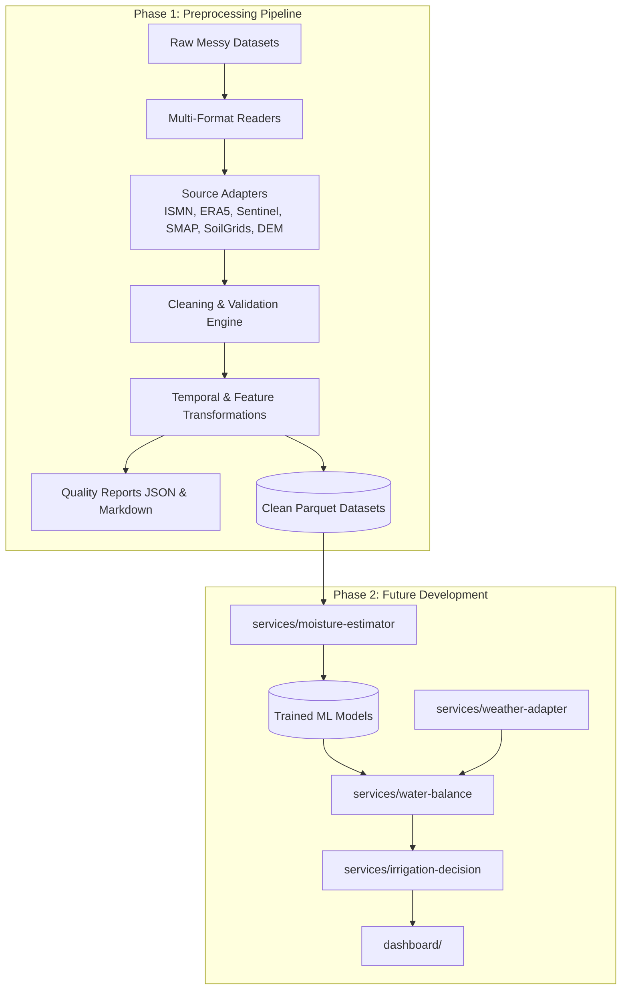
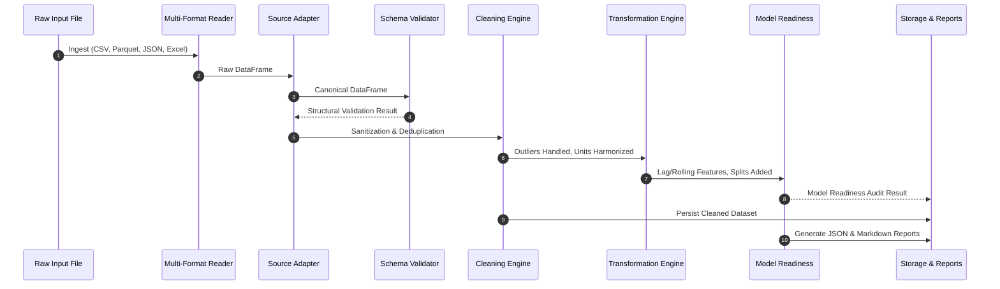

# SoilDepth-AI: System Architecture

SoilDepth-AI is an artificial-intelligence-driven system for root-zone soil moisture estimation ($0-100\text{ cm}$) and irrigation decision support.

---

## 1. Architectural Philosophy: Preprocessing First

Root-zone soil moisture estimation fuses heterogeneous spatial, temporal, and physical observation datasets:
- **In-Situ Sensors:** Ground stations (e.g., ISMN) provide ground truth at point locations but have varying sensor depths, calibrations, and missing periods.
- **Reanalysis Weather:** Atmospheric models (ERA5-Land) provide continuous gridded meteorology but are model outputs rather than direct ground truth.
- **Remote Sensing:** Synthetic Aperture Radar (Sentinel-1) and Radiometry (SMAP) offer surface soil moisture sensitivity but suffer from vegetation attenuation and revisit gaps.
- **Static Covariates:** Soil texture (SoilGrids) and topography (DEM) are time-invariant but have spatial resolutions and scale offsets.

Feeding unvalidated, inconsistently formatted, or leaking data directly into ML estimators produces brittle models that fail under operational field conditions. The **Data Preprocessing Pipeline** isolates and solves ingestion, data sanitation, unit harmonization, and leakage prevention before any model training occurs.

---

## 2. Directory Layout & Service Boundaries

| Directory | Role | Status |
| :--- | :--- | :--- |
| `data-pipeline/` | Reusable preprocessing engine, readers, cleaners, transforms, quality reports. | **Implemented (Active Phase)** |
| `data/` | Data storage layout: `raw/`, `processed/`, `reports/`. | Structured (`.gitkeep`) |
| `services/moisture-estimator/` | ML model training, inference pipelines, and depth interpolation. | Future Phase (Stubbed) |
| `services/weather-adapter/` | Live meteorological API integrations and forecast fetching. | Future Phase (Stubbed) |
| `services/water-balance/` | Physical FAO-56 Penman-Monteith evapotranspiration & soil water simulator. | Future Phase (Stubbed) |
| `services/irrigation-decision/` | Prescription engine calculating irrigation timing and application depths. | Future Phase (Stubbed) |
| `models/` | Serialized model artifacts, checkpoints, and scalers. | Future Phase (Stubbed) |
| `dashboard/` | Interactive map interface, time-series visualization, and irrigation alerts. | Future Phase (Stubbed) |

---

## 3. Preprocessing Execution Lifecycle

---

## 4. Scientific Ground Truth Policy

1. **In-Situ vs. Modeled Soil Moisture**:
   - Only validated in-situ measurements (e.g. ISMN ground sensors) are marked as `is_ground_truth: True` and allowed to serve as direct `TARGET` labels.
   - Reanalysis estimates (ERA5 `swvl1-4`) and satellite assimilations (SMAP L4 root-zone) are treated as **input features**, NEVER ground truth.
2. **Leakage Isolation**:
   - Lagged features must strictly reference past observations (`lag > 0`). Peering into future data raises an immediate error.
   - Train/test splitting must be strictly chronological or grouped by sensor station.
