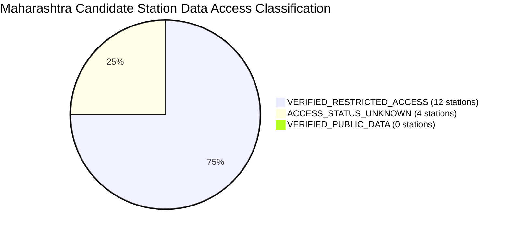

# SoilDepth-AI — Maharashtra Ground-Truth Acquisition Registry

**Document ID:** `DOC-MAHA-GT-REGISTRY-2026`  
**Phase:** Phase 2D (Multi-Station Expansion & Ground-Truth Readiness)  
**Standard:** ISO-19115 (Metadata) / SoilDepth-AI Quality Assurance Policy  
**Branch:** `main`  
**Last Updated:** 2026-10-31  

---

## 1. Scope & Objective

This registry provides a systematic inventory of all 16 candidate in-situ ground-truth soil moisture observation stations identified across Maharashtra. In strict adherence to SoilDepth-AI scientific integrity standards:
- **No station's access status is upgraded without documentary or programmatic evidence.**
- **No synthetic ground truth is fabricated.**
- **Point-probe measurements are strictly separated from layer-integrated measurements.**

---

## 2. Station Classification & Status Definitions

Each station is audited and classified under one of the following explicit categories:

| Status Code | Definition | Criterion for Assignment |
| :--- | :--- | :--- |
| `VERIFIED_PUBLIC_DATA` | Publicly downloadable without credentials or institutional gating. | Programmatic HTTP download verified; public data repository active. |
| `VERIFIED_RESTRICTED_ACCESS` | Station existence and operational data verified, but access requires formal institutional requisition, government clearances, or paid supply. | Peer-reviewed literature, official agency directory, or government data portal confirmation. |
| `ACCESS_STATUS_UNKNOWN` | Station verified physically operational, but digital data archiving continuity or telemetry accessibility is unverified. | University research farm verified, but online portal is unavailable or records are archived in paper agronomy logbooks. |
| `REQUEST_SENT` | Formal data requisition letter or RTI application submitted to custodian authority. | Dispatch timestamp, reference ID, and receiving agency logged. |
| `DATA_RECEIVED` | Raw data archive received from custodian. | Physical files staged in `dataset/Maharashtra/COSMOS/raw/<station_id>/`. |
| `DATA_VERIFIED` | Raw data passed schema validation, timestamp monotonicity, and physical sanity audit. | Cryptographic manifest generated and audit tests passing. |
| `DATA_REJECTED` | Data received fails quality, integrity, or physical plausibility tests. | Unresolvable sensor calibration defects or extensive missingness. |

---

## 3. Comprehensive Station Inventory (16 Candidate Stations)

### 3.1 Western Maharashtra Region (6 Stations)

#### 1. `IITM-PUNE-COSMOS` (Pune District)
- **Institution:** Indian Institute of Tropical Meteorology (IITM Pune) / MoES-NERC COSMOS-India
- **Coordinates:** $18.5372^\circ\text{ N}, 73.8051^\circ\text{ E}$ | **Elevation:** $560.0\text{ m}$ (Benchmark) / $591.58\text{ m}$ (DEM)
- **Measurement Modality:** Cosmic-Ray Neutron Probe (CRNS, $0–30\text{ cm}$ integrated profile) + Stevens Hydra Probe FDR point probes ($5, 15, 50\text{ cm}$).
- **Period & Sampling:** 2017-01-01 to Present | Hourly
- **Classification:** `VERIFIED_RESTRICTED_ACCESS`
- **Request Status:** `REQUEST_SENT` (Official request submitted to CCCR/IITM Pune; awaiting approval)
- **Evidence:** Mujumdar et al. (2021) *J. Hydrol.*; Upadhyaya et al. (2021); COSMOS-India Network Directory.

#### 2. `IMD-AGRIMET-PUNE` (Pune District)
- **Institution:** India Meteorological Department (IMD) Agrimet Division / National Data Centre (NDC)
- **Coordinates:** $18.5308^\circ\text{ N}, 73.8507^\circ\text{ E}$ | **Elevation:** $559.0\text{ m}$ AMSL
- **Measurement Modality:** Digital Capacitive Probes (SDI-12) + Gravimetric core auger ($10, 30, 70, 100\text{ cm}$).
- **Period & Sampling:** 2013-01-01 to Present | Hourly / Daily
- **Classification:** `VERIFIED_RESTRICTED_ACCESS`
- **Request Status:** `REQUEST_DRAFTED` (Requires commercial supply payment via Ministry of Earth Sciences Bharatkosh Portal Min 081 and Non-Commercial Research Undertaking).
- **Evidence:** IMD Agrimet Network Directory; National Data Centre Portal (`dsp.imdpune.gov.in`).

#### 3. `MPKV-RAHURI-CAAST` (Ahmednagar District)
- **Institution:** Mahatma Phule Krishi Vidyapeeth (MPKV), Rahuri / ICAR-NAHEP CAAST-CSAWM
- **Coordinates:** $19.3932^\circ\text{ N}, 74.6475^\circ\text{ E}$ | **Elevation:** $512.0\text{ m}$ AMSL
- **Measurement Modality:** Multi-depth IoT Capacitive/FDR telemetry probes ($10, 20, 30, 60\text{ cm}$) under precision automated irrigation network.
- **Period & Sampling:** 2018-06-01 to Present | Hourly / 15-min
- **Classification:** `VERIFIED_RESTRICTED_ACCESS`
- **Request Status:** `REQUEST_DRAFTED` (Requires institutional MoU / academic data sharing agreement with Vice-Chancellor, MPKV Rahuri).
- **Evidence:** World Bank / ICAR-NAHEP CAAST-CSAWM Annual Reports (`mpkv-caast.ac.in`).

#### 4. `NIASM-BARAMATI-FLUX` (Pune District)
- **Institution:** ICAR - National Institute of Abiotic Stress Management (NIASM), Baramati
- **Coordinates:** $18.1519^\circ\text{ N}, 74.5828^\circ\text{ E}$ | **Elevation:** $550.0\text{ m}$ AMSL
- **Measurement Modality:** Multi-depth TDR Probes ($5, 15, 30, 60, 100\text{ cm}$) + Eddy Covariance Flux Tower + Lysimeter.
- **Period & Sampling:** 2014-01-01 to Present | 30-min / Daily
- **Classification:** `VERIFIED_RESTRICTED_ACCESS`
- **Request Status:** `REQUEST_DRAFTED` (Formal ICAR institutional requisition to Director, ICAR-NIASM).
- **Evidence:** ICAR-NIASM Annual Reports; National Eddy Covariance Network Database (`niam.res.in`).

#### 5. `AICRPDA-SOLAPUR` (Solapur District)
- **Institution:** Zonal Agricultural Research Station (ZARS), Solapur / AICRPDA / MPKV
- **Coordinates:** $17.6621^\circ\text{ N}, 75.9103^\circ\text{ E}$ | **Elevation:** $479.0\text{ m}$ AMSL
- **Measurement Modality:** Gravimetric core profile + Neutron Moisture Probe / FDR profile ($0–15, 15–30, 30–60, 60–90, 90–120\text{ cm}$).
- **Period & Sampling:** 2015-01-01 to Present | Weekly / Event-based
- **Classification:** `VERIFIED_RESTRICTED_ACCESS`
- **Request Status:** `REQUEST_DRAFTED` (Requisition to Project Coordinator AICRPDA / Director CRIDA Hyderabad).
- **Evidence:** AICRPDA All-India Dryland Research Network Technical Bulletins (`crida.in`).

#### 6. `NHP-CWC-PUNE` (Pune District)
- **Institution:** Central Water Commission (CWC) / National Hydrology Project (NHP)
- **Coordinates:** $18.5204^\circ\text{ N}, 73.8567^\circ\text{ E}$ | **Elevation:** $560.0\text{ m}$ AMSL
- **Measurement Modality:** Automated in-situ hydrological soil moisture probe ($0–10\text{ cm}$ surface and root-zone).
- **Period & Sampling:** 2018-01-01 to Present | Daily
- **Classification:** `VERIFIED_RESTRICTED_ACCESS`
- **Request Status:** `REQUEST_DRAFTED` (India-WRIS portal user registration and departmental approval).
- **Evidence:** National Hydrology Project Station Directory; India-WRIS Portal (`indiawris.gov.in`).

---

### 3.2 Vidarbha Region (4 Stations)

#### 7. `NBSSLUP-NAGPUR-HQ` (Nagpur District)
- **Institution:** ICAR - National Bureau of Soil Survey & Land Use Planning (NBSS&LUP), Nagpur
- **Coordinates:** $21.1332^\circ\text{ N}, 79.0305^\circ\text{ E}$ | **Elevation:** $312.0\text{ m}$ AMSL
- **Measurement Modality:** TDR Multi-Depth Probes + Long-term Benchmark Pedon Monitoring ($0–15, 15–30, 30–60, 60–100\text{ cm}$).
- **Period & Sampling:** 2012-01-01 to Present | Daily / Campaign
- **Classification:** `VERIFIED_RESTRICTED_ACCESS`
- **Request Status:** `REQUEST_DRAFTED` (Formal ICAR Requisition via Bhoomi Geoportal).
- **Evidence:** ICAR-NBSS&LUP Benchmark Soil Series Reports; Bhoomi Geoportal (`bhoomigeoportal-nbsslup.in`).

#### 8. `PDKV-AKOLA-CRS` (Akola District)
- **Institution:** Dr. Panjabrao Deshmukh Krishi Vidyapeeth (Dr. PDKV), Akola / AICRPDA
- **Coordinates:** $20.7025^\circ\text{ N}, 77.0315^\circ\text{ E}$ | **Elevation:** $282.0\text{ m}$ AMSL
- **Measurement Modality:** Gravimetric Core Auger + Multi-Depth TDR Probes ($0–15, 15–30, 30–45, 45–60, 60–90\text{ cm}$).
- **Period & Sampling:** 2015-01-01 to Present | Weekly / Daily campaign
- **Classification:** `VERIFIED_RESTRICTED_ACCESS`
- **Request Status:** `REQUEST_DRAFTED` (Requisition to Director of Research, Dr. PDKV Akola).
- **Evidence:** AICRPAM / AICRPDA Annual Reports; Dr. PDKV University Bulletins (`pdkv.ac.in`).

#### 9. `POCRA-AMRAVATI-DARYAPUR` (Amravati District)
- **Institution:** Project on Climate Resilient Agriculture (PoCRA), Dept of Agriculture, Govt of Maharashtra
- **Coordinates:** $20.9284^\circ\text{ N}, 77.3182^\circ\text{ E}$ | **Elevation:** $288.0\text{ m}$ AMSL
- **Measurement Modality:** Multi-depth IoT Capacitive Soil Probes ($10, 30, 60, 100\text{ cm}$).
- **Period & Sampling:** 2019-06-01 to Present | Hourly / Daily
- **Classification:** `VERIFIED_RESTRICTED_ACCESS`
- **Request Status:** `REQUEST_DRAFTED` (Requires State Project Director, PoCRA Mumbai clearance).
- **Evidence:** World Bank Implementation Status & Results Reports; PoCRA Soil Health Dashboard (`mahapocra.gov.in`).

#### 10. `CICR-NAGPUR-FARM` (Nagpur District)
- **Institution:** ICAR - Central Institute for Cotton Research (CICR), Nagpur
- **Coordinates:** $21.0617^\circ\text{ N}, 79.0614^\circ\text{ E}$ | **Elevation:** $310.0\text{ m}$ AMSL
- **Measurement Modality:** Capacitive FDR Probes + Neutron Moisture Gauge ($15, 30, 60, 90, 120\text{ cm}$).
- **Period & Sampling:** 2015-06-01 to Present | Weekly (Kharif-Rabi)
- **Classification:** `VERIFIED_RESTRICTED_ACCESS`
- **Request Status:** `REQUEST_DRAFTED` (ICAR Institutional Requisition to Director, ICAR-CICR).
- **Evidence:** ICAR-CICR Rainfed Cotton Agrometeorology Trials (`cicr.icar.gov.in`).

---

### 3.3 Marathwada Region (2 Stations)

#### 11. `VNMKV-PARBHANI-CRS` (Parbhani District)
- **Institution:** Vasantrao Naik Marathwada Krishi Vidyapeeth (VNMKV), Parbhani / AICRPDA
- **Coordinates:** $19.2638^\circ\text{ N}, 76.7824^\circ\text{ E}$ | **Elevation:** $408.0\text{ m}$ AMSL
- **Measurement Modality:** Gravimetric Core Sampling + Digital Capacitive Sensors ($0–15, 15–30, 30–45, 45–60, 60–100\text{ cm}$).
- **Period & Sampling:** 2015-06-01 to Present | Weekly / Seasonal
- **Classification:** `VERIFIED_RESTRICTED_ACCESS`
- **Request Status:** `REQUEST_DRAFTED` (Requisition to Director of Research, VNMKV Parbhani).
- **Evidence:** AICRPAM Parbhani Agromet Bulletins (`vnmkv.ac.in`).

#### 12. `POCRA-JALNA-BADNAPUR` (Jalna District)
- **Institution:** PoCRA / ICAR-NBSS&LUP / Dept of Agriculture, Maharashtra
- **Coordinates:** $19.8692^\circ\text{ N}, 75.7258^\circ\text{ E}$ | **Elevation:** $508.0\text{ m}$ AMSL
- **Measurement Modality:** Multi-depth IoT Capacitive Probes ($10, 30, 60, 100\text{ cm}$).
- **Period & Sampling:** 2020-01-01 to Present | Hourly / Daily
- **Classification:** `VERIFIED_RESTRICTED_ACCESS`
- **Request Status:** `REQUEST_DRAFTED` (State Project Director Departmental Clearance).
- **Evidence:** PoCRA Cluster Monitoring Dashboard (`mahapocra.gov.in`).

---

### 3.4 Khandesh & Scarcity Region (2 Stations)

#### 13. `MPKV-JALGAON-ORS` (Jalgaon District)
- **Institution:** Oilseeds Research Station (ORS), Jalgaon / MPKV Rahuri
- **Coordinates:** $21.0116^\circ\text{ N}, 75.5678^\circ\text{ E}$ | **Elevation:** $210.0\text{ m}$ AMSL
- **Measurement Modality:** Gravimetric Core Auger + Experimental FDR ($0–15, 15–30, 30–60, 60–90\text{ cm}$).
- **Period & Sampling:** 2016-01-01 to Present | Weekly (Seasonal)
- **Classification:** `ACCESS_STATUS_UNKNOWN` (Station operational, but continuous digital archiving unverified; physical agronomy logbooks).
- **Request Status:** `REQUEST_DRAFTED`
- **Evidence:** MPKV Research Station Directory (`mpkv.ac.in`).

#### 14. `MPKV-DHULE-ARS` (Dhule District)
- **Institution:** Agricultural Research Station (ARS) Scarcity Farm, Dhule / MPKV Rahuri
- **Coordinates:** $20.9042^\circ\text{ N}, 74.7749^\circ\text{ E}$ | **Elevation:** $260.0\text{ m}$ AMSL
- **Measurement Modality:** Gravimetric Core Auger ($0–15, 15–30, 30–45, 45–60\text{ cm}$).
- **Period & Sampling:** 2016-06-01 to Present | Weekly (Kharif/Rabi)
- **Classification:** `ACCESS_STATUS_UNKNOWN` (Intermittent campaign sampling).
- **Request Status:** `REQUEST_DRAFTED`
- **Evidence:** MPKV Scarcity Zone Agronomy Bulletins (`mpkv.ac.in`).

---

### 3.5 Konkan Coastal Region (2 Stations)

#### 15. `BSKKV-DAPOLI-CENTRAL` (Ratnagiri District)
- **Institution:** Dr. Balasaheb Sawant Konkan Krishi Vidyapeeth (BSKKV), Dapoli
- **Coordinates:** $17.7594^\circ\text{ N}, 73.1906^\circ\text{ E}$ | **Elevation:** $240.0\text{ m}$ AMSL
- **Measurement Modality:** Campaign FDR Probes + Gravimetric Core ($0–15, 15–30, 30–45\text{ cm}$).
- **Period & Sampling:** 2016-01-01 to Present | Weekly / Campaign
- **Classification:** `ACCESS_STATUS_UNKNOWN` (High rainfall laterite soil; data continuity unverified).
- **Request Status:** `REQUEST_DRAFTED`
- **Evidence:** BSKKV Research Council Proceedings (`bskkv.org`).

#### 16. `BSKKV-KARJAT-ARS` (Raigad District)
- **Institution:** Regional Agricultural Research Station (Rice Specialist), Karjat / Dr. BSKKV
- **Coordinates:** $18.9103^\circ\text{ N}, 73.3282^\circ\text{ E}$ | **Elevation:** $52.0\text{ m}$ AMSL
- **Measurement Modality:** Hydrological Water Table Dipwells + Gravimetric Core Sampling ($0–15, 15–30\text{ cm}$).
- **Period & Sampling:** 2016-06-01 to Present | Weekly (Kharif season)
- **Classification:** `ACCESS_STATUS_UNKNOWN` (Lowland rice ecosystem; continuous soil moisture unverified).
- **Request Status:** `REQUEST_DRAFTED`
- **Evidence:** BSKKV Regional Station Profiles; National Rice Research Archive (`bskkv.org`).
