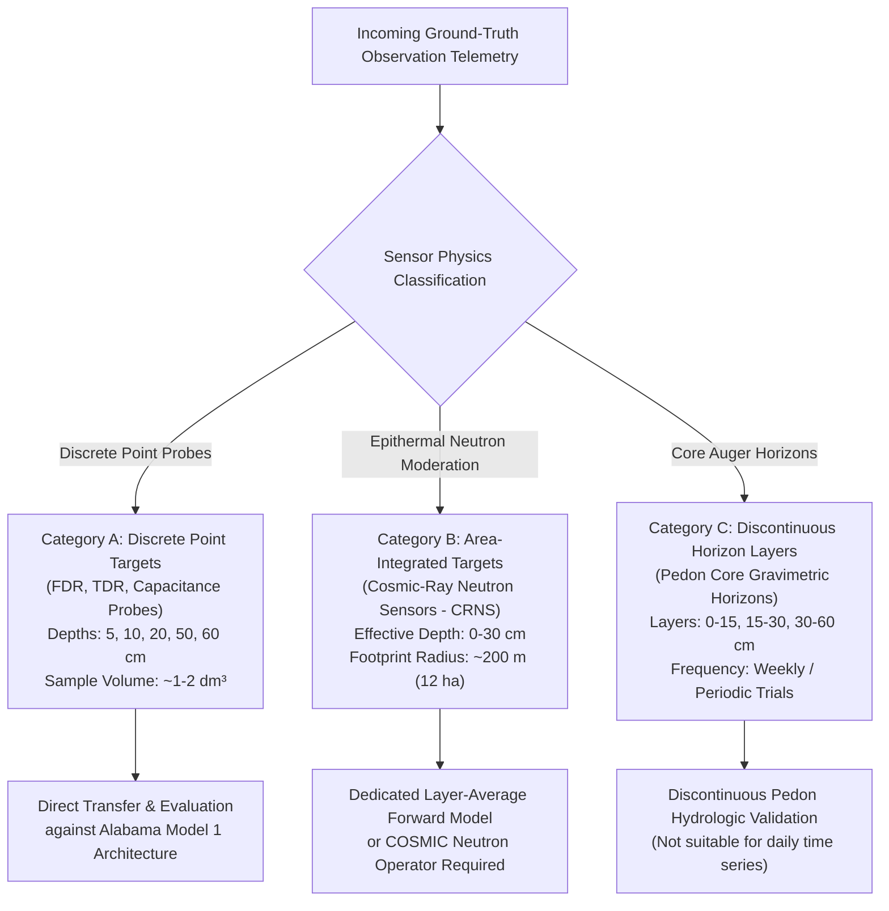

# SoilDepth-AI — Maharashtra Ground-Truth Acquisition Campaign Status

**Document ID:** `DOC-MAHA-GT-STATUS-2026`  
**Phase:** Phase 2E (Ground-Truth Acquisition Campaign)  
**Standard:** SoilDepth-AI Data Governance & Provenance Policy  
**Date:** November 3, 2026  
**Status:** Approved Campaign Baseline  

---

## 1. Executive Summary & Status Audit

Phase 2E transitions SoilDepth-AI from environmental predictor preparation to an active institutional ground-truth acquisition campaign across Maharashtra State, India.

A rigorous audit of previous status claims was conducted against direct repository evidence:
- **Status Audit Finding:** Prior documentation in Phase 2D designated `IITM-PUNE-COSMOS` as `REQUEST_SENT`. A thorough audit reveals that while the formal requisition parameters were formulated, **no documentary record of electronic transmission, portal receipt, or institutional acknowledgement exists in the repository**.
- **Evidence-Based Correction:** In accordance with SoilDepth-AI high-assurance integrity rules, the status for `IITM-PUNE-COSMOS` is formally corrected to **`DRAFTED_NOT_SENT`**.
- **Statewide Summary (16 Candidate Stations):**
  - **Merely Identified as Necessary (`MERELY_IDENTIFIED`):** **11 stations** (68.75%)
  - **Drafted but Not Sent (`DRAFTED_NOT_SENT`):** **5 stations** (31.25%: IITM, IMD, MPKV, NIASM, PoCRA)
  - **Actually Submitted (`REQUEST_SUBMITTED`):** **0 stations** (0.00%)
  - **Acknowledged by Institution (`REQUEST_ACKNOWLEDGED`):** **0 stations** (0.00%)
  - **Approved (`REQUEST_APPROVED`):** **0 stations** (0.00%)
  - **Data Received (`DATA_RECEIVED`):** **0 stations** (0.00%)
  - **Data Independently Verified (`DATA_VERIFIED`):** **0 stations** (0.00%)

> [!IMPORTANT]
> **Zero synthetic ground-truth data has been fabricated.** No ground truth will be marked as submitted or verified until physical files, transmission logs, or formal receipts are deposited and verified.

---

## 2. Institutional Requisition Inventory

Formal, comprehensive, professional academic request letters have been drafted and deposited under [`docs/data_acquisition/maharashtra/requests/`](file:///c:/Users/adars/OneDrive/Documents/PROJECTS/SoilDepth-AI/docs/data_acquisition/maharashtra/requests/):

| Ref ID | Target Institution & Observatory | Request File | Custodian Contact & Mechanism | Requested Modalities & Depths | Status |
| :---: | :--- | :--- | :--- | :--- | :---: |
| `REQ-001` | **IITM / MoES** (`IITM-PUNE-COSMOS`) | [`iitm_moes_cosmos_pune_request.md`](file:///c:/Users/adars/OneDrive/Documents/PROJECTS/SoilDepth-AI/docs/data_acquisition/maharashtra/requests/iitm_moes_cosmos_pune_request.md) | Director, IITM Pune / CCCR (`director@tropmet.res.in`, `hmru-cosmos@tropmet.res.in`) | Hourly fast neutron counts ($N, N_{\text{corr}}$), CRNS $0\text{--}30\text{ cm}$ area-integrated VWC, Hydra Probe FDR at 5, 15, 50 cm. | `DRAFTED_NOT_SENT` |
| `REQ-002` | **ICAR-NIASM** (`NIASM-BARAMATI-FLUX`) | [`icar_niasm_baramati_request.md`](file:///c:/Users/adars/OneDrive/Documents/PROJECTS/SoilDepth-AI/docs/data_acquisition/maharashtra/requests/icar_niasm_baramati_request.md) | Director, ICAR-NIASM Baramati (`director.niasm@icar.gov.in`) | Multi-depth TDR probes at 10, 20, 30, 50 cm, soil temp, eddy covariance surface fluxes. | `DRAFTED_NOT_SENT` |
| `REQ-003` | **MPKV Rahuri** (`MPKV-RAHURI-CAAST`) | [`mpkv_rahuri_caast_request.md`](file:///c:/Users/adars/OneDrive/Documents/PROJECTS/SoilDepth-AI/docs/data_acquisition/maharashtra/requests/mpkv_rahuri_caast_request.md) | Director of Research & PI, CAAST-CSAWM (`dr_mpkv@rediffmail.com`, `caast.csawm2018@gmail.com`) | IoT capacitive probe network at 10, 20, 30, 60 cm across experimental farm, on-site AWS. | `DRAFTED_NOT_SENT` |
| `REQ-004` | **IMD NDC Pune** (`IMD-AGRIMET-PUNE`) | [`imd_national_data_centre_request.md`](file:///c:/Users/adars/OneDrive/Documents/PROJECTS/SoilDepth-AI/docs/data_acquisition/maharashtra/requests/imd_national_data_centre_request.md) | Head, National Data Centre, IMD Pune (`dsp.imdpune.gov.in`) | Digital capacitive / gravimetric at 10, 30, 70, 100 cm, daily pan evaporation, soil temp. | `DRAFTED_NOT_SENT` |
| `REQ-005` | **Maharashtra PoCRA PMU** (`POCRA-DARYAPUR` & `JALNA`) | [`maharashtra_pocra_pmu_request.md`](file:///c:/Users/adars/OneDrive/Documents/PROJECTS/SoilDepth-AI/docs/data_acquisition/maharashtra/requests/maharashtra_pocra_pmu_request.md) | State Project Director, PoCRA Mumbai (`pmu.pocra@gov.in`) | Micro-watershed IoT soil moisture sensors at 10, 20, 40 cm in Amravati & Jalna clusters. | `DRAFTED_NOT_SENT` |

---

## 3. Required Ground-Truth Data Definitions & Segregation

To ensure high-assurance physical validity, incoming ground-truth observations must be strictly partitioned into three distinct target classes:



### Prohibited Conflation Rule:
Point sensor observations ($\theta(z)$ at a single depth) and area-integrated CRNS observations ($\bar{\theta}_{0-30}$ over $200\text{ m}$) **must never be pooled into a single target column or trained using the same loss function** without an explicit physical or spatial forward transformation.

---

## 4. Depth Compatibility Summary (vs Alabama Model 1)

From the [`dataset/Maharashtra/metadata/depth_compatibility_matrix.csv`](file:///c:/Users/adars/OneDrive/Documents/PROJECTS/SoilDepth-AI/dataset/Maharashtra/metadata/depth_compatibility_matrix.csv):

| Alabama Model 1 Target Depth | ISMN Nominal Horizon | Maharashtra Direct Matches ($\le \pm 1.0\text{ cm}$) | Available Maharashtra Observatories | Non-Matching Probes (Separate Models Required) |
| :---: | :---: | :---: | :--- | :--- |
| **5.08 cm** (2 in) | Surface | $5.0\text{ cm}$ (Offset $0.08\text{ cm}$) | `BSKKV-DAPOLI-CENTRAL` | Missing at most stations; relies on satellite surface proxies |
| **10.16 cm** (4 in) | Shallow root | $10.0\text{ cm}$ (Offset $0.16\text{ cm}$) | `IMD-AGRIMET-PUNE`, `MPKV-RAHURI-CAAST`, `NIASM-BARAMATI-FLUX`, `POCRA-AMRAVATI`, `POCRA-JALNA`, `VNMKV-PARBHANI`, `BSKKV-DAPOLI` | `AICRPDA-SOLAPUR` ($15\text{ cm}$), `CICR-NAGPUR` ($15\text{ cm}$) |
| **20.32 cm** (8 in) | Mid root | $20.0\text{ cm}$ (Offset $0.32\text{ cm}$) | `MPKV-RAHURI-CAAST`, `NIASM-BARAMATI-FLUX`, `POCRA-AMRAVATI`, `POCRA-JALNA`, `VNMKV-PARBHANI`, `BSKKV-DAPOLI` | `IMD-AGRIMET-PUNE` ($30\text{ cm}$), `AICRPDA` ($30\text{ cm}$) |
| **50.80 cm** (20 in) | Deep root | $50.0\text{ cm}$ (Offset $0.80\text{ cm}$) | `NIASM-BARAMATI-FLUX`, `VNMKV-PARBHANI`, `BSKKV-DAPOLI` | `MPKV-RAHURI-CAAST` ($60\text{ cm}$), `IMD-AGRIMET` ($70\text{ cm}$) |

> [!CAUTION]
> **No Synthetic Depth Fabrication:** Interpolating between 10 cm and 30 cm to fabricate a "20 cm" measurement is strictly prohibited. If a physical probe does not exist at a target depth, that depth remains unmeasured.

---

## 5. Earliest Scientifically Feasible Pilot Configuration

Based on the [`docs/data_acquisition/maharashtra/institutional_data_request_priority.md`](file:///c:/Users/adars/OneDrive/Documents/PROJECTS/SoilDepth-AI/docs/data_acquisition/maharashtra/institutional_data_request_priority.md), the earliest feasible training configuration for Maharashtra is the **Western Maharashtra Triangle Pilot**:

```
================================================================================
MINIMUM FEASIBLE MAHARASHTRA TRAINING CLUSTER:
1. IMD-AGRIMET-PUNE     (10 cm probe / Bharatkosh Portal Purchase)
2. MPKV-RAHURI-CAAST    (10 cm & 20 cm probes / Academic SAU Agreement)
3. NIASM-BARAMATI-FLUX  (10 cm, 20 cm & 50 cm probes / ICAR Research MOU)
================================================================================
```

### Key Advantages:
1. **Model 1 Direct Compatibility:** Provides physical ground truth for 10 cm, 20 cm, and 50 cm without interpolation.
2. **Spatial Autocorrelation Independence:** Inter-station distances ($85\text{--}140\text{ km}$) permit genuine Leave-One-Station-Out cross-validation.
3. **Contrast in Hydrological Systems:** Compares heavy Vertisol canal-irrigated sugarcane/wheat (Rahuri) against rain-shadow water-stressed Inceptisol sorghum/chickpea (Baramati) and urban agromet transition (Pune).
4. **Feasible Administrative Timeline:** IMD data can be purchased via Bharatkosh within 1–2 weeks; MPKV and NIASM require standard bilateral academic data-use agreements.

---

## 6. Training Readiness Decision

```
================================================================================
MAHARASHTRA SUPERVISED MODEL TRAINING READINESS:
ENVIRONMENTAL DATA PIPELINE:   APPROVED & OPERATIONAL (GO)
IN-SITU GROUND TRUTH:          BLOCKED AWAITING DELIVERY (NO-GO)
OVERALL DECISION:              NO-GO FOR MODEL 2 TRAINING
================================================================================
```

Model 2 regional training will remain blocked until at least one Tier 1 ground-truth dataset is formally delivered and validated through the 10-gate protocol in [`ground_truth_ingestion_protocol.md`](file:///c:/Users/adars/OneDrive/Documents/PROJECTS/SoilDepth-AI/docs/data_acquisition/maharashtra/ground_truth_ingestion_protocol.md).
