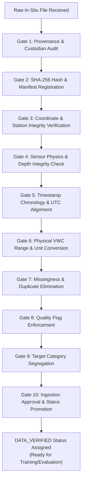

# SoilDepth-AI — Maharashtra Ground-Truth Data Ingestion & Verification Protocol

**Document ID:** `DOC-MAHA-GT-INGESTION-2026`  
**Phase:** Phase 2E (Ground-Truth Acquisition Campaign)  
**Standard:** ISO-19157 (Geographic Information — Data Quality) & SoilDepth-AI High-Assurance QA  
**Date:** November 3, 2026  
**Status:** Approved Operational Protocol  

---

## 1. Objective and Scope

This protocol establishes a repeatable, auditable, and automated 10-step procedure for ingesting, standardizing, validating, and cryptographically hashing incoming in-situ ground-truth soil moisture datasets from institutional providers across Maharashtra (IITM, IMD, SAUs, ICAR, PoCRA).

### Core Quality Principle:
No in-situ dataset shall be marked as `DATA_VERIFIED` or ingested into model training/validation pipelines until it successfully passes all ten verification gates detailed herein.



---

## 2. The 10-Gate Verification Procedure

### Gate 1: File Provenance & Custodian Authentication
- **Objective:** Verify that the file originated from an authenticated institutional source.
- **Verification Rule:**
  - Must identify the transmitting institution, recipient email/portal confirmation, sender name, official release reference, and date of transmission.
  - Unsolicited, anonymous, or synthetic data files are permanently rejected.
- **Status if Failed:** `DATA_REJECTED_UNVERIFIED_PROVENANCE`.

### Gate 2: Cryptographic SHA-256 Hashing & Immutable Archiving
- **Objective:** Guarantee immutability of original raw files.
- **Verification Rule:**
  - The unmodified raw file is stored in `dataset/Maharashtra/<CUSTODIAN>/raw/<STATION_ID>/`.
  - Compute SHA-256 digest on the immutable raw binary stream:
    ```bash
    Get-FileHash -Algorithm SHA256 <filepath>
    ```
  - Record the digest, byte size, file format, and ingestion timestamp into `acquisition_manifest.json`.
- **Status if Failed:** `DATA_REJECTED_INTEGRITY_FAIL`.

### Gate 3: Station Identity & Coordinate Consistency Check
- **Objective:** Ensure observations match the physical benchmark station.
- **Verification Rule:**
  - Compare reported station coordinates $(\text{Lat}_{\text{file}}, \text{Lon}_{\text{file}})$ against official station registry benchmark $(\text{Lat}_{\text{reg}}, \text{Lon}_{\text{reg}})$.
  - Distance threshold: $\Delta d \le 0.05^\circ$ ($\approx 5\text{ km}$).
  - Verify that the station falls within the declared Maharashtra district.
- **Status if Failed:** `DATA_REJECTED_COORDINATE_MISMATCH`.

### Gate 4: Sensor Physics & Depth Integrity Check
- **Objective:** Verify sensor horizons and enforce zero synthetic depth fabrication.
- **Verification Rule:**
  - Check sensor depth $z$: must be a positive physical depth ($0 < z \le 200\text{ cm}$).
  - Compare recorded depths against documented station sensor array in `station_registry.csv`.
  - **Absolute Prohibition on Synthetic Interpolation:** Any file containing interpolated, extrapolated, or synthetic depth values (e.g. creating 20 cm by averaging 10 cm and 30 cm) is strictly rejected by `MaharashtraGroundTruthAdapter`.
- **Status if Failed:** `DATA_REJECTED_PROHIBITED_INTERPOLATION`.

### Gate 5: Timestamp Chronology & UTC Alignment
- **Objective:** Guarantee monotonic time series and eliminate timezone ambiguity.
- **Verification Rule:**
  - Determine original timezone: Indian Standard Time (IST, UTC+05:30) or UTC.
  - Convert all timestamps to ISO 8601 UTC: `YYYY-MM-DDTHH:MM:SSZ`.
  - Check for chronological monotonicity (`df['timestamp'].is_monotonic_increasing`).
  - Flag and remove clock drift or out-of-order records.
- **Status if Failed:** `DATA_REJECTED_TIMESTAMP_ERROR`.

### Gate 6: Physical VWC Range & Unit Conversion
- **Objective:** Enforce thermodynamic and physical boundaries for mineral soil moisture.
- **Verification Rule:**
  - Identify reported units:
    - If in volumetric percentage ($0\text{--}100\%$), divide by 100.
    - If in gravimetric moisture (% dry weight), require measured bulk density ($\rho_{bd}$) to compute $\theta = w \cdot (\rho_{bd} / \rho_w)$; otherwise flag as unconvertible.
  - Strict physical boundary check for Maharashtra Vertisols/Inceptisols:
    $$0.00 \le \theta_{\text{VWC}} \le 0.65\text{ m}^3/\text{m}^3$$
  - Any raw measurement $\theta < 0.00$ or $\theta > 0.65\text{ m}^3/\text{m}^3$ is flagged as `OUT_OF_BOUNDS`.
- **Status if Failed:** `DATA_REJECTED_PHYSICAL_OUT_OF_BOUNDS`.

### Gate 7: Missingness Profile & Duplicate Elimination
- **Objective:** Eliminate multiple records per timestep and assess observation continuity.
- **Verification Rule:**
  - Check for duplicate rows matching on `(station_id, sensor_depth_cm, timestamp)`. Duplicates must be resolved using deterministic aggregation (e.g. mean of co-located sensors) or latest transmission.
  - Compute total calendar days, valid observation count, and gap distribution.
  - Missing observations must be preserved as explicit `NaN` (never forward-filled or zero-imputed in ground truth).
- **Status if Failed:** `DATA_REJECTED_UNRESOLVED_DUPLICATES`.

### Gate 8: Sensor-Specific Quality Flag Enforcement
- **Objective:** Filter sensor anomalies, battery brownouts, and calibration spikes.
- **Verification Rule:**
  - Retain only observations with verified quality flag `GOOD`.
  - Exclude observations flagged as:
    - `CALIBRATION_PERIOD`
    - `SENSOR_MALFUNCTION`
    - `SUSPECT`
    - `OUT_OF_BOUNDS`
    - `FROZEN_SOIL`
- **Status if Failed:** Records flagged non-good are filtered from model training sets.

### Gate 9: Target Category Segregation
- **Objective:** Prevent invalid mixing of point sensors and footprint integrators.
- **Verification Rule:**
  - Route data into distinct target classes:
    - **Category A (Point Sensors):** Discrete in-situ FDR/TDR probes at $z_i \in \{5, 10, 20, 50, 60\}\text{ cm}$. Used for point-scale supervised learning.
    - **Category B (CRNS Area-Integrated):** $0\text{--}30\text{ cm}$ effective profile average. Used strictly for footprint-scale layer-average models.
    - **Category C (Layer-Average / Pedon Cores):** Discontinuous horizon-averaged values. Used for pedon validation.
  - Point models trained on ISMN cannot be directly evaluated against Category B without a neutron forward operator.
- **Status if Failed:** `DATA_REJECTED_TARGET_CONFLATION`.

### Gate 10: Ingestion Approval & Status Promotion
- **Objective:** Formal sign-off and status promotion in project tracking files.
- **Verification Rule:**
  - Generate automated data verification summary via `MaharashtraGroundTruthAdapter.validate()`.
  - If all checks pass:
    - Assign status `DATA_VERIFIED`.
    - Update `dataset/Maharashtra/metadata/station_registry.csv` and `docs/data_acquisition/maharashtra/ground_truth_request_tracker.md`.
    - Save normalized clean frame to `dataset/Maharashtra/COSMOS/processed/<STATION_ID>/ground_truth_verified.csv`.
- **Final Result:** Dataset approved for supervised training and validation.

---

## 3. Automated Validation Script Execution

When a new raw ground-truth dataset is received, execute the standardized verification harness:

```bash
python -c "
from services.data_acquisition.maharashtra.ground_truth_adapter import MaharashtraGroundTruthAdapter
import pandas as pd

adapter = MaharashtraGroundTruthAdapter()
raw_df = pd.read_csv('path/to/raw_received_data.csv')
mapping = {
    'timestamp': 'DateTime',
    'sensor_depth_cm': 'Depth',
    'soil_moisture_vwc': 'VWC',
    'quality_flag': 'Flag'
}
df_norm = adapter.normalize(raw_df, mapping, source_dataset='IITM-PUNE-COSMOS', default_station_id='IITM-PUNE-COSMOS')
report = adapter.validate(df_norm)
print('Validation Report:', report)
"
```

Only when `report['is_valid'] == True` may the dataset be committed to the repository and utilized for model training.

