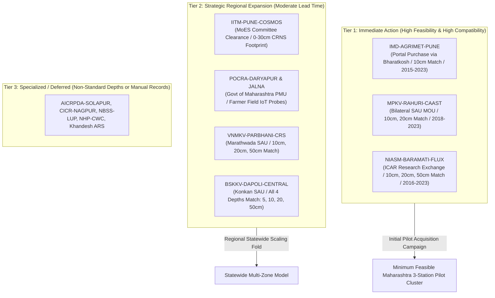

# SoilDepth-AI — Maharashtra Institutional Data Request Priority & Pilot Plan

**Document ID:** `DOC-MAHA-REQ-PRIORITY-2026`  
**Phase:** Phase 2E (Ground-Truth Acquisition Campaign)  
**Standard:** SoilDepth-AI Decision Framework & High-Assurance QA  
**Date:** November 3, 2026  
**Status:** Approved Operational Strategy  

---

## 1. Multi-Criteria Prioritization Framework

To maximize the probability of obtaining verified ground-truth soil moisture datasets within minimal lead time, candidate stations are evaluated across seven objective criteria:

1. **Acquisition Feasibility & Administrative Friction (Weight: 25%):** Established commercial or academic self-service portal (e.g. IMD NDC) > Bilateral SAU academic MOU (MPKV/PDKV) > ICAR institutional clearance (NIASM/CICR) > Inter-governmental project clearance (PoCRA) > Ministry committee review (MoES/IITM).
2. **Historical Observation Span (Weight: 20%):** $\ge 5$ continuous years preferred to support temporal holdout evaluation (2017–2021 train, 2022 validation, 2023 test).
3. **Sensor Depth Compatibility with Model 1 (Weight: 20%):** Proximity to Alabama ISMN benchmark depths ($5.08\text{ cm}$, $10.16\text{ cm}$, $20.32\text{ cm}$, $50.8\text{ cm}$).
4. **Measurement Frequency & Automation (Weight: 15%):** Automated hourly/daily digital telemetry (FDR, TDR, capacitance) > Periodic manual gravimetric core sampling.
5. **Crop & Agronomic Relevance (Weight: 10%):** Coverage of Maharashtra's primary commercial cash crops and foodgrains (Sugarcane, Soybean, Cotton, Wheat, Chickpea, Sorghum).
6. **Agro-Ecological Diversity (Weight: 5%):** Balanced spatial representation across Western Ghats transition, Central canal plateau, Marathwada dryland plateau, and Vidarbha heavy Vertisol plains.
7. **Sensor Physics Homogeneity (Weight: 5%):** Separation of discrete point probes from area-integrated footprint sensors (CRNS).

---

## 2. Institutional Priority Tier Architecture

### 2.1 Tier 1: Immediate High-Feasibility Stations (Target Pilot Cluster)

| Priority | Station ID | Custodian Institution | Feasibility Route | Compatibility Score | Primary Crops | Strategic Role |
| :---: | :--- | :--- | :--- | :---: | :--- | :--- |
| **#1** | **`IMD-AGRIMET-PUNE`** | India Meteorological Department (NDC Pune) | **High (Commercial/Academic Portal Purchase via Bharatkosh)** | **50%** (10 cm matches Model 1; 30/70/100 cm separate) | Sugarcane, Wheat, Chickpea | Established statutory portal; no bilateral committee negotiations required; standard WMO observation protocols. |
| **#2** | **`MPKV-RAHURI-CAAST`** | MPKV Rahuri / ICAR-NAHEP CAAST-CSAWM | **High (Academic Research MOU with SAU)** | **50%** (10 cm and 20 cm match Model 1; 30/60 cm separate) | Sugarcane, Wheat, Chickpea, Soybean | High-precision IoT capacitance probe array; prime canal-irrigated Vertisol agronomic ecosystem; strong academic partnership potential. |
| **#3** | **`NIASM-BARAMATI-FLUX`** | ICAR - National Institute of Abiotic Stress Management | **High (ICAR Research Data-Sharing MOU)** | **75%** (10 cm, 20 cm, and 50 cm match Model 1) | Sorghum, Chickpea, Sugarcane, Wheat | Multi-depth TDR profiles coupled with eddy covariance energy flux tower; crucial rain-shadow abiotic water stress baseline; 50 cm deep probe matches Model 1. |

### 2.2 Tier 2: Strategic Regional Expansion Stations

| Priority | Station ID | Custodian Institution | Feasibility Route | Compatibility Score | Primary Crops | Strategic Role |
| :---: | :--- | :--- | :--- | :---: | :--- | :--- |
| **#4** | **`IITM-PUNE-COSMOS`** | IITM Pune / MoES | **Medium (MoES Committee Clearance)** | **0% (Layer-Average)** (CRNS 0–30 cm footprint) | Sugarcane, Wheat, Maize | Unique non-invasive ~200 m footprint integrator; essential for dedicated layer-average satellite downscaling calibration. |
| **#5** | **`POCRA-AMRAVATI-DARYAPUR`** | Dept of Agriculture Maharashtra / World Bank | **Medium (State PMU Clearance)** | **50%** (10 cm and 20 cm match Model 1; 40 cm separate) | Cotton, Soybean, Pigeon pea | Real-world farmer field IoT sensor telemetry in the core Vidarbha heavy cotton Vertisol tract. |
| **#6** | **`POCRA-JALNA-BADNAPUR`** | Dept of Agriculture Maharashtra / World Bank | **Medium (State PMU Clearance)** | **50%** (10 cm and 20 cm match Model 1; 40 cm separate) | Cotton, Soybean, Pigeon pea | Smallholder dryland micro-watershed telemetry in the Marathwada drought-prone plateau. |
| **#7** | **`VNMKV-PARBHANI-CRS`** | VNMKV Parbhani (SAU) | **Medium (SAU Academic MOU)** | **75%** (10 cm, 20 cm, and 50 cm match Model 1) | Soybean, Cotton, Pigeon pea, Sorghum | Key Marathwada regional university agromet observatory; matches 3 of 4 Model 1 depths. |
| **#8** | **`BSKKV-DAPOLI-CENTRAL`** | Dr. BSKKV Dapoli (SAU) | **Medium (SAU Academic MOU)** | **100%** (All 4 depths match: 5, 10, 20, 50 cm) | Lowland Rice, Groundnut | Perfect theoretical depth match against Alabama Model 1; represents the high-rainfall Konkan coastal belt. |

---

## 3. The Minimum Feasible Maharashtra Pilot Cluster

To establish a scientifically sound, defensible, and achievable pilot without waiting for statewide institutional approvals, we define the **Minimum Feasible Maharashtra 3-Station Pilot**:

### Selected Pilot Stations:
1. `IMD-AGRIMET-PUNE` (Urban/agromet transition, Western Maharashtra, $18.5308^\circ\text{ N}, 73.8507^\circ\text{ E}$, $559.0\text{ m}$)
2. `MPKV-RAHURI-CAAST` (Canal-irrigated Vertisol plain, Central Maharashtra, $19.3932^\circ\text{ N}, 74.6475^\circ\text{ E}$, $512.0\text{ m}$)
3. `NIASM-BARAMATI-FLUX` (Rain-shadow water-stressed Inceptisol, Southern Western Maharashtra, $18.1506^\circ\text{ N}, 74.5772^\circ\text{ E}$, $555.0\text{ m}$)

### Why this 3-Station Combination is Scientifically Defensible:
1. **Model 1 Depth Coverage Without Interpolation:**
   - **$10.16\text{ cm}$ Target:** Present at all 3 stations ($10.0\text{ cm}$, error $0.16\text{ cm}$).
   - **$20.32\text{ cm}$ Target:** Present at Rahuri and Baramati ($20.0\text{ cm}$, error $0.32\text{ cm}$).
   - **$50.80\text{ cm}$ Target:** Present at Baramati ($50.0\text{ cm}$, error $0.80\text{ cm}$).
   - **$5.08\text{ cm}$ Target:** Evaluated on Sentinel-1 SAR surface proxies or deferred until surface probe data is acquired.
2. **Spatial Validation Independence:**
   - Linear separation between Pune and Rahuri: $\sim 130\text{ km}$.
   - Linear separation between Pune and Baramati: $\sim 85\text{ km}$.
   - Linear separation between Rahuri and Baramati: $\sim 140\text{ km}$.
   - All pairwise distances substantially exceed the spatial correlation length scale ($\sim 30\text{--}50\text{ km}$), enabling true Leave-One-Station-Out (LOSO) spatial cross-validation.
3. **Contrasting Hydrological & Irrigation Regimes:**
   - **Rahuri:** Heavy smectitic Vertisol with perennial canal irrigation for sugarcane.
   - **Baramati:** Shallow gravelly Inceptisol with severe deficit irrigation and abiotic stress.
   - **Pune:** Semi-urban agrometeorological grass plot with monsoon-dominant wetting cycles.
4. **Actionable Acquisition Pathways:**
   - IMD NDC can be purchased immediately via Bharatkosh without committee delays.
   - MPKV and NIASM require standard bilateral academic research agreements between university departments.
