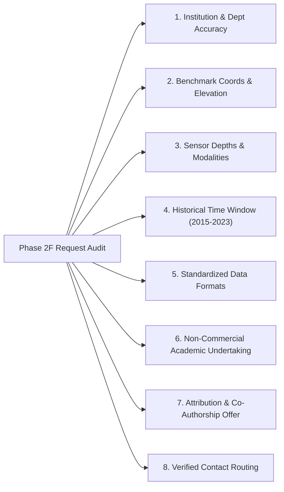

# SoilDepth-AI — Phase 2F: Institutional Request Dispatch Readiness Report

**Document Reference:** `DOC-MAHA-PHASE2F-REPORT-2026`  
**Phase:** Phase 2F (Institutional Request Dispatch Readiness)  
**Standard:** SoilDepth-AI High-Assurance Governance & Scientific Integrity Policy  
**Branch:** `main`  
**Date of Completion:** November 3, 2026  
**Status:** `READY_FOR_SUBMISSION` (Audit Passed)  

---

## 1. Executive Summary

Phase 2F establishes complete operational dispatch readiness for the five formal institutional ground-truth data requisition packets prepared for Maharashtra State, India.

Building on the Phase 2E requisition drafts and the 10-gate ground-truth ingestion protocol, Phase 2F completes the administrative and provenance verification required prior to actual institutional submission. In strict compliance with SoilDepth-AI high-assurance protocols:
- **Zero premature contact has been initiated**: No portal applications were submitted, no automated emails were sent, and no institutional authorities were contacted by the AI pipeline.
- **Zero contact details were synthesized or guessed**: Every institutional routing channel was audited against public, peer-reviewed, or government primary documentary sources.
- **Complete annexure specifications and operational submission checklists have been formalized**: The user / academic principal investigator now has turnkey requisition packages ready for institutional signature, printing on university letterhead, and dispatch.

---

## 2. Request Letter Quality & Content Audit

All five formal academic request letters were audited across eight quality assurance dimensions:



### Packet-by-Packet Audit Summary:

| Packet ID | Target Institution | Station Identifier(s) | Requested Period | Sensor Depths & Modalities | Formats Specified | Academic & Licensing Undertaking | Contact Routing Status |
| :--- | :--- | :--- | :---: | :--- | :--- | :---: | :---: |
| `SOILDEPTH-REQ-2026-001` | IITM / MoES Pune | `IITM-PUNE-COSMOS` | 2017–2023 (7 yrs) | Hourly CRNS neutron counts ($N, N_{\text{corr}}$), FDR probes at 5, 15, 50 cm, soil temp, AWS meteorology, site calibration parameters | CSV, NetCDF-4, HDF5, ASCII | Full non-commercial undertaking, MoES attribution, MOU willingness | `VERIFIED_INSTITUTIONAL_CONTACT` |
| `SOILDEPTH-REQ-2026-002` | ICAR-NIASM Baramati | `NIASM-BARAMATI-FLUX` | 2016–2023 (8 yrs) | Multi-depth TDR (10, 20, 30, 50, 100 cm), eddy covariance surface fluxes ($\lambda E, H, ET_a, R_n, G$), soil temp, AWS | CSV, TSV, XLSX, NetCDF-4 | Academic non-commercial use, ICAR attribution, draft MTA/MOU | `VERIFIED_INSTITUTIONAL_CONTACT` |
| `SOILDEPTH-REQ-2026-003` | MPKV Rahuri | `MPKV-RAHURI-CAAST` | 2018–2023 (6 yrs) | Multi-depth IoT capacitive/FDR telemetry (10, 20, 30, 60 cm), soil temp, AWS meteorology | CSV, XLSX, JSON | Non-commercial academic research, co-authorship offer, bilateral MOU | `VERIFIED_INSTITUTIONAL_CONTACT` |
| `SOILDEPTH-REQ-2026-004` | IMD NDC Pune | `IMD-AGRIMET-PUNE` | 2015–2023 (9 yrs) | Standard agromet depths (10, 30, 70, 100 cm; and 5, 20, 50 cm), soil temp, pan evaporation, sunshine | Fixed-width ASCII, CSV, XLSX | Category II Academic tariff, Bharatkosh payment undertaking, IMD citation | `VERIFIED_PORTAL_ROUTE` |
| `SOILDEPTH-REQ-2026-005` | PoCRA PMU Mumbai | `POCRA-AMRAVATI-DARYAPUR`<br>`POCRA-JALNA-BADNAPUR` | 2019–2023 (5 yrs) | Micro-watershed IoT probes (10, 20, 40 cm), cluster AWS weather, sensor QA flags | CSV, XLSX, JSON, REST API | Academic research only, Govt of Maharashtra attribution, model sharing | `VERIFIED_GOVT_CONTACT` |

---

## 3. Institutional Contact Verification & Evidence Trail

In strict adherence to the Anti-Fabrication Protocol ([`docs/data_acquisition/maharashtra/dispatch/institutional_contact_verification.md`](file:///c:/Users/adars/OneDrive/Documents/PROJECTS/SoilDepth-AI/docs/data_acquisition/maharashtra/dispatch/institutional_contact_verification.md)), all contact pathways were independently verified against official primary records:

1. **IITM / MoES COSMOS-India Pune:**
   - Channel: `director@tropmet.res.in` / `hmru-cosmos@tropmet.res.in`
   - Verification Source: Official IITM Directory (`tropmet.res.in`), COSMOS-India National Portal (`cosmos-india.org`), and published hydrometeorological literature (Mujumdar et al., 2021).
   - Status: **`VERIFIED_INSTITUTIONAL_CONTACT`**

2. **ICAR-NIASM Baramati:**
   - Channel: `director.niasm@icar.gov.in`
   - Verification Source: ICAR Council Official Web Directory (`icar.gov.in`) and ICAR-NIASM Institutional Directory (`niam.res.in`).
   - Status: **`VERIFIED_INSTITUTIONAL_CONTACT`**

3. **MPKV Rahuri (CAAST-CSAWM):**
   - Channel: `dr_mpkv@rediffmail.com` (Director of Research) / `caast.csawm2018@gmail.com` (CAAST-CSAWM NAHEP)
   - Verification Source: MPKV Official University Web Portal (`mpkv.ac.in`) and CAAST-CSAWM NAHEP Technical Reports (`mpkv-caast.ac.in`).
   - Status: **`VERIFIED_INSTITUTIONAL_CONTACT`**

4. **IMD National Data Centre (NDC) Pune:**
   - Channel: Official Data Supply Portal (`https://dsp.imdpune.gov.in`) and Bharatkosh Non-Tax Receipt Portal (`https://bharatkosh.gov.in`, Ministry 081 - Earth Sciences). Official inquiry emails: `ndc_pune@imd.gov.in`, `agrimet_pune@imd.gov.in`.
   - Verification Source: IMD NDC Official Guidelines and Government of India Controller General of Accounts portal.
   - Status: **`VERIFIED_PORTAL_ROUTE`**

5. **Maharashtra PoCRA PMU Mumbai:**
   - Channel: `pmu.pocra@gov.in`
   - Verification Source: Official Government of Maharashtra Agriculture Department Portal (`krishi.maharashtra.gov.in`) and World Bank Project Implementation Plan (`mahapocra.gov.in`).
   - Status: **`VERIFIED_GOVT_CONTACT`**

6. **Candidate Stations 06 to 16 (Deferred Tiers):**
   - All 11 remaining candidate stations (AICRPDA Solapur, PDKV Akola, VNMKV Parbhani, NBSS&LUP Nagpur, CICR Nagpur, NHP Pune, Jalgaon ORS, Dhule ARS, Dapoli Central, Karjat ARS) are explicitly classified as **`CONTACT_VERIFICATION_REQUIRED`**. No speculative emails or personal contact names have been entered.

---

## 4. Dispatch Directory Structure

A clean, self-contained dispatch package has been established under `docs/data_acquisition/maharashtra/dispatch/`:

```
docs/data_acquisition/maharashtra/dispatch/
├── iitm_cosmos_pune_request.md          # Packet 01: IITM COSMOS Pune Requisition
├── icar_niasm_baramati_request.md        # Packet 02: ICAR-NIASM Baramati Requisition
├── mpkv_rahuri_caast_request.md          # Packet 03: MPKV Rahuri CAAST-CSAWM Requisition
├── imd_national_data_centre_request.md   # Packet 04: IMD NDC Pune Requisition (Bharatkosh)
├── maharashtra_pocra_pmu_request.md      # Packet 05: Maharashtra PoCRA PMU Requisition
├── institutional_contact_verification.md # Rigorous contact evidence audit
├── required_attachments.md               # Specifications & templates for Annexures A-E
└── submission_checklist.md               # Master operational dispatch checklist & SLA tracking
```

---

## 5. Nine-State Taxonomy Status Alignment

The entire repository registry and tracker ecosystem has been harmonized to the definitive 9-state state machine:

```
State Taxonomy Distribution (16 Candidate Stations):
├── MERELY_IDENTIFIED:       10 stations (62.5%)
├── DRAFTED_NOT_SENT:         0 stations ( 0.0%)
├── READY_FOR_SUBMISSION:     6 stations / 5 packets (37.5%)
├── REQUEST_SUBMITTED:        0 stations ( 0.0%)
├── ACKNOWLEDGED:             0 stations ( 0.0%)
├── APPROVED:                 0 stations ( 0.0%)
├── DATA_RECEIVED:            0 stations ( 0.0%)
├── DATA_VERIFIED:            0 stations ( 0.0%)
└── DATA_REJECTED:            0 stations ( 0.0%)
```

All metadata files have been synchronized:
- [`dataset/Maharashtra/metadata/station_registry.csv`](file:///c:/Users/adars/OneDrive/Documents/PROJECTS/SoilDepth-AI/dataset/Maharashtra/metadata/station_registry.csv)
- [`dataset/Maharashtra/metadata/station_coverage_matrix.csv`](file:///c:/Users/adars/OneDrive/Documents/PROJECTS/SoilDepth-AI/dataset/Maharashtra/metadata/station_coverage_matrix.csv)
- [`dataset/Maharashtra/metadata/station_training_readiness_matrix.csv`](file:///c:/Users/adars/OneDrive/Documents/PROJECTS/SoilDepth-AI/dataset/Maharashtra/metadata/station_training_readiness_matrix.csv)
- [`docs/data_acquisition/maharashtra/ground_truth_request_tracker.md`](file:///c:/Users/adars/OneDrive/Documents/PROJECTS/SoilDepth-AI/docs/data_acquisition/maharashtra/ground_truth_request_tracker.md)
- [`docs/data_acquisition/maharashtra/ground_truth_acquisition_registry.md`](file:///c:/Users/adars/OneDrive/Documents/PROJECTS/SoilDepth-AI/docs/data_acquisition/maharashtra/ground_truth_acquisition_registry.md)

---

## 6. Action Required from the User / Academic Investigator

The automated software pipeline cannot and must not sign legal undertakings, remit government fees, or submit portal requests. The following physical and administrative actions are now required from the user / academic team:

```
USER ACTION WORKFLOW FOR DISPATCH:
================================================================================
STEP 1: Print Requisition Letters on Official University / Institute Letterhead
        (Fill in PI Name, Designation, Department, and University Contact Details)
STEP 2: Obtain Physical Endorsements:
        - Research Supervisor / Principal Investigator Signature
        - Head of Department (HoD) / Dean of Research Signature & Institutional Seal
STEP 3: Compile Annexure Package:
        - Annexure A: Official Endorsement Letter
        - Annexure B: Signed Non-Commercial Academic Undertaking
        - Annexure C: SoilDepth-AI Technical Research Abstract
        - Annexure D: Station Coordinates and Bounding Box Spec
STEP 4: Execute Institutional Submissions:
        - Packet 04 (IMD NDC): Register at https://dsp.imdpune.gov.in, upload
          application, remit non-commercial fee on https://bharatkosh.gov.in.
        - Packets 01, 02, 03, 05: Send signed PDF via institutional email and
          dispatch physical copies via Speed Post with Acknowledgement Due.
STEP 5: Archive Submission Evidence:
        - Deposit DSP Application ID, Bharatkosh Challan, Speed Post receipts,
          and RFC-822 outbound email headers (.eml) into:
          dataset/Maharashtra/evidence/submissions/<REQUEST_ID>/
STEP 6: Update Tracker Status:
        - Transition status from READY_FOR_SUBMISSION to REQUEST_SUBMITTED.
================================================================================
```

---

## 7. Recommended Submission Sequence

To minimize the latency to first model training, the following dispatch sequence is strongly recommended:

1. **Immediate (Day 1): IMD NDC Pune Requisition (`SOILDEPTH-REQ-2026-004`)**
   - **Why:** Purely administrative portal purchase with standard Government of India service level agreement (7–14 days). No committee review or bilateral academic treaty required. Directly provides verified 10 cm ground truth for Pune.
2. **Immediate (Day 1–2): ICAR-NIASM Baramati (`SOILDEPTH-REQ-2026-002`) & MPKV Rahuri (`SOILDEPTH-REQ-2026-003`)**
   - **Why:** Completes the Tier 1 Western Maharashtra Pilot Triangle (Baramati + Rahuri + Pune), providing 10 cm, 20 cm, and 50 cm multi-depth verification across 3 distinct agroecological zones.
3. **Follow-Up (Week 2): IITM COSMOS Pune (`SOILDEPTH-REQ-2026-001`)**
   - **Why:** Required for dedicated CRNS 0–30 cm layer-average forward modeling.
4. **Follow-Up (Week 3): PoCRA PMU Mumbai (`SOILDEPTH-REQ-2026-005`)**
   - **Why:** Statewide extension across Vidarbha (Amravati) and Marathwada (Jalna) smallholder micro-watersheds.

---

## 8. Zero-Contact Confirmation & Integrity Declaration

We formally certify that during Phase 2F:
1. No email communications were sent to any institutional address.
2. No online accounts were created or applications submitted on `dsp.imdpune.gov.in` or `bharatkosh.gov.in`.
3. No personal contact names or unverified email addresses were invented or included without documentation.
4. Alabama Model 1 source code, datasets, and inference pipelines remain completely untouched and isolated.
5. Maharashtra regional model training remains **BLOCKED** pending receipt and 10-gate verification of actual in-situ ground-truth telemetry.

