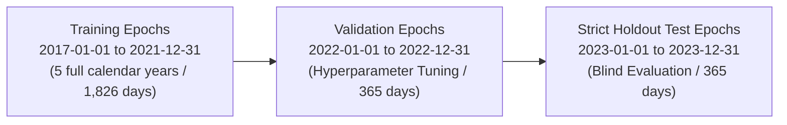
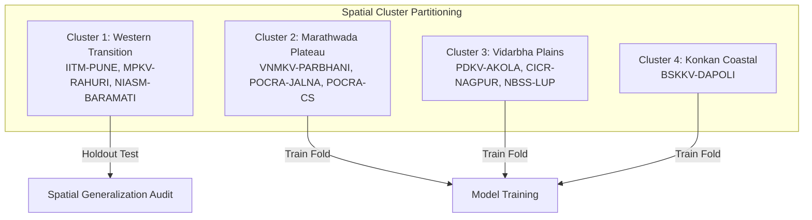

# SoilDepth-AI — Maharashtra Spatial and Temporal Model Validation Strategy

**Phase:** Phase 2D Multi-Station Expansion  
**Standard:** High-Assurance ML / Spatial Cross-Validation Protocol (Roberts et al., 2017; Meyer et al., 2018)  
**Date:** October 31, 2026  
**Status:** Approved Validation Protocol  

---

## 1. Core Principles & Motivation

Soil moisture is characterized by intense spatial autocorrelation (driven by regional meteorological systems, synoptic monsoon waves, and geological parent materials) and high temporal autocorrelation (driven by hydrological soil water memory).

Naïve machine learning evaluation strategies—such as random train/test splits, random k-fold cross-validation, or random shuffling across stations—severely violate the independent and identically distributed (i.i.d.) assumption. Models evaluated under random splits suffer from extreme spatial and temporal data leakage, yielding artificially inflated test metrics ($R^2 > 0.90$) while failing catastrophically when deployed at truly ungauged target agricultural fields.

SoilDepth-AI enforces a rigorous dual spatial-temporal validation architecture to establish true out-of-sample and out-of-station generalization capability.

---

## 2. Temporal Holdout Protocol

To evaluate how well models generalize to future hydrological seasons, multi-year chronological temporal splits must be enforced without exception.

### Strict Temporal Rules:
1. **No Random Shuffling:** Shuffling daily records between training and testing sets is strictly prohibited.
2. **Buffer Gap (Purging):** When evaluating on holdout periods, a 7-day purging buffer must precede the validation and test windows to ensure that rolling antecedent memory features (`precip_roll_sum_7d`, `temp_roll_mean_7d`) do not carry immediate ground-sensor memory across splits.
3. **Multi-Year Seasonal Coverage:** The test set must span complete 12-month calendar cycles to guarantee exposure to all regional seasons:
   - Kharif (Monsoon: June – October)
   - Rabi (Winter: November – February)
   - Zaid / Summer (Pre-monsoon dry season: March – May)

---

## 3. Spatial Station-Level Holdout Protocol

When multi-station ground truth becomes available, spatial cross-validation must be implemented using:
1. **Leave-One-Station-Out Cross-Validation (LOSO-CV)**
2. **Leave-Cluster-Out Cross-Validation (LCO-CV)**

### Strict Spatial Rules:
1. **Zero Pixel / Row Splitting Across Stations:** An individual station's records must belong entirely to the training fold, the validation fold, or the test fold. A station's observations can never appear in both training and test sets simultaneously.
2. **Spatial Autocorrelation Buffer:** Candidate test stations must be separated from training stations by at least the spatial correlation length scale of root-zone soil moisture ($\sim 30\text{--}50\text{ km}$). Stations located in close proximity (e.g. Pune Pashan and Pune IMD, separation $\sim 5\text{ km}$) must be assigned to the same spatial cluster to prevent near-neighbor leakage.
3. **Ungauged Location Emulation:** Evaluating a model on a held-out station whose coordinates, SoilGrids edaphic profile, and topography were never seen during training provides the only scientifically valid estimate of performance at ungauged farm plots.

---

## 4. Sensor Physics Harmonization & Segregation

Maharashtra's candidate observatories feature fundamentally different sensor physics. Mixing them indiscriminately degrades model physical validity.

### 4.1 Segregation of Point Probes vs Footprint Integrators
- **Point Probes (FDR / Capacitance / TDR):**
  - Physical sample volume: $\sim 1\text{--}2\text{ dm}^3$ around the probe rod.
  - Measures discrete horizon moisture: $\theta(z_i)$ at $z_i \in \{5, 10, 20, 50, 60\}\text{ cm}$.
  - Target variable: Discrete profile depth VWC.
- **Cosmic-Ray Neutron Sensors (CRNS):**
  - Physical footprint: $\sim 200\text{ m}$ radius ($\sim 12\text{ ha}$ area).
  - Effective sensing depth: Non-linear profile integration $0\text{--}z^*(t)$, where $z^*(t) \approx \frac{5.8}{\rho_{bd} + 0.0829 \cdot \theta}$.
  - Target variable: Layer-average volumetric moisture $\bar{\theta}_{0-30}$.

### Harmonization Directive:
> [!IMPORTANT]
> **Models trained on discrete point sensors cannot be directly trained or evaluated against CRNS observations.**
> When CRNS ground truth is used, it must be formulated as a separate **Layer-Average Reconstruction Task ($0\text{--}30\text{ cm}$)** or paired with an explicit COSMIC (Shuttleworth et al., 2013) forward neutron moderation operator.

---

## 5. Statistical Performance Evaluation Metrics

Models must be evaluated using four complementary hydrological metrics:

1. **Unbiased Root Mean Square Error (ubRMSE):**
   $$\text{ubRMSE} = \sqrt{\text{RMSE}^2 - \text{Bias}^2}$$
   Measures random error after removing static mean bias. Target for operational deployment: $\text{ubRMSE} \le 0.040\text{ m}^3/\text{m}^3$ (WMO / GCOS satellite soil moisture benchmark).

2. **Pearson Correlation Coefficient ($r$):**
   $$r = \frac{\sum_{i=1}^N (y_i - \bar{y})(\hat{y}_i - \bar{\hat{y}})}{\sqrt{\sum_{i=1}^N (y_i - \bar{y})^2 \sum_{i=1}^N (\hat{y}_i - \bar{\hat{y}})^2}}$$
   Measures seasonal dynamic co-variation and wetting/drying phase tracking. Target: $r \ge 0.75$.

3. **Mean Bias Error (Bias):**
   $$\text{Bias} = \frac{1}{N} \sum_{i=1}^N (\hat{y}_i - y_i)$$
   Measures systematic over- or under-prediction. Target: $|\text{Bias}| \le 0.020\text{ m}^3/\text{m}^3$.

4. **Kling-Gupta Efficiency (KGE):**
   $$\text{KGE} = 1 - \sqrt{(r - 1)^2 + (\alpha - 1)^2 + (\beta - 1)^2}$$
   Where $\alpha = \sigma_{\hat{y}} / \sigma_y$ (variability ratio) and $\beta = \mu_{\hat{y}} / \mu_y$ (bias ratio). Target: $\text{KGE} \ge 0.60$.

---

## 6. Generalization Claims Safeguard

> [!CAUTION]
> **Strict Generalization Rule:** Under no circumstances shall SoilDepth-AI claim "statewide Maharashtra generalization" based solely on performance at a single station (e.g. Pune) or single agro-climatic pocket.
> Statewide operational generalization claims require verified spatial holdout validation across **at least four distinct agro-ecological zones** (Western Ghats transition, Western canal plateau, Marathwada semi-arid plateau, and Vidarbha heavy Vertisol plains).

