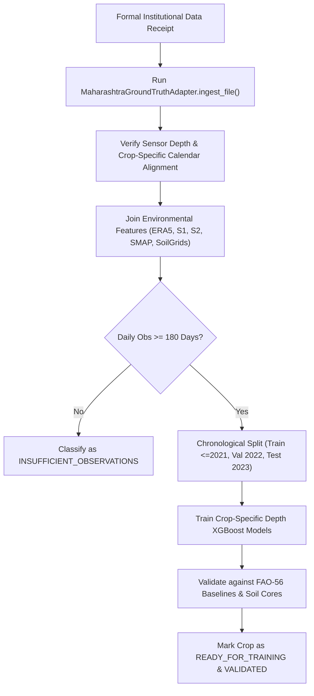

# SoilDepth-AI — Maharashtra Multi-Crop Scientific Readiness Analysis

**Author:** Agronomic ML Systems Engineer & Hydrological Scientist, SoilDepth-AI  
**Target Region:** Entire Maharashtra State (Marathwada, Vidarbha, Western Maharashtra, Khandesh, Konkan)  
**Report Date:** 2026-11-04  
**Status:** COMPLETE AUDIT & AGRONOMIC SPECIFICATION  

---

## 1. Executive Summary

SoilDepth-AI's agricultural intelligence mandate covers the 10 major crops of Maharashtra, representing over 90% of the state's cropped acreage and irrigation water withdrawal.

Every crop has been parameterized with peer-reviewed FAO-56 crop coefficients ($K_c$), rooting depths ($Z_r$), allowable depletion fractions ($p$), and critical phenological stress stages.

However, in accordance with the project's strict scientific data integrity mandate:
**No crop is marked `READY_FOR_TRAINING` because zero verified in-situ soil moisture observations have yet been delivered by institutional providers.**

All 10 crops are formally classified as `INSUFFICIENT_GROUND_TRUTH` / `NOT_VALIDATED`.

---

## 2. Multi-Crop Scientific Classification Matrix

The classification uses the standard four-tier readiness taxonomy:
- `READY_FOR_TRAINING`: Verified in-situ ground truth ($\ge 180$ daily observations) aligned with multi-modal predictors.
- `INSUFFICIENT_GROUND_TRUTH`: Agronomic metadata verified, but in-situ field sensor observations are zero or $< 180$ days.
- `METADATA_PENDING`: Phenological, root depth, or $K_c$ parameters incomplete.
- `NOT_VALIDATED`: Model predictions have not been evaluated against independent in-situ harvest/soil cores.

| Crop ID | Crop Name | Botanical Name | Season | Effective Root Depth ($Z_r$) | Required Sensor Depths | FAO-56 $K_c$ (Ini/Mid/End) | Allowable Depletion $p$ | Institutional Pairing Station | Current Status |
|---|---|---|---|---|---|---|---|---|---|
| `CROP-SOYBEAN` | Soybean | *Glycine max* | Kharif | 30–50 cm | 10, 20, 40 cm | 0.40 / 1.15 / 0.50 | 0.50 | MPKV Rahuri / NIASM Baramati | `INSUFFICIENT_GROUND_TRUTH` |
| `CROP-COTTON` | Cotton | *Gossypium hirsutum* | Kharif / Perennial | 50–90 cm | 10, 30, 60, 100 cm | 0.35 / 1.20 / 0.65 | 0.65 | CICR Nagpur / Rahuri CAAST | `INSUFFICIENT_GROUND_TRUTH` |
| `CROP-RICE` | Lowland Rice | *Oryza sativa* | Kharif | 20–40 cm | 10, 30 cm | 1.05 / 1.20 / 0.90 | 0.20 | Dr. BSKKV Dapoli | `INSUFFICIENT_GROUND_TRUTH` |
| `CROP-WHEAT` | Wheat | *Triticum aestivum* | Rabi | 40–70 cm | 10, 20, 40, 60 cm | 0.40 / 1.15 / 0.40 | 0.55 | MPKV Rahuri CAAST | `INSUFFICIENT_GROUND_TRUTH` |
| `CROP-SUGARCANE` | Sugarcane | *Saccharum officinarum* | Perennial | 50–80 cm | 10, 30, 60, 100 cm | 0.40 / 1.25 / 0.75 | 0.65 | VSI Pune / Baramati Flux | `INSUFFICIENT_GROUND_TRUTH` |
| `CROP-MAIZE` | Maize (Corn) | *Zea mays* | Kharif & Rabi | 40–60 cm | 10, 20, 40, 60 cm | 0.40 / 1.20 / 0.60 | 0.55 | NIASM Baramati / Rahuri | `INSUFFICIENT_GROUND_TRUTH` |
| `CROP-CHICKPEA` | Chickpea (Gram) | *Cicer arietinum* | Rabi | 40–60 cm | 10, 30, 60 cm | 0.40 / 1.00 / 0.35 | 0.65 | MPKV Rahuri / PoCRA | `INSUFFICIENT_GROUND_TRUTH` |
| `CROP-PIGEONPEA` | Pigeon pea (Tur) | *Cajanus cajan* | Kharif/Post-monsoon | 60–100 cm | 10, 30, 60, 100 cm | 0.35 / 1.15 / 0.40 | 0.70 | VNMKV Parbhani / Rahuri | `INSUFFICIENT_GROUND_TRUTH` |
| `CROP-GROUNDNUT` | Groundnut | *Arachis hypogaea* | Kharif & Summer | 30–50 cm | 10, 20, 40 cm | 0.40 / 1.15 / 0.60 | 0.50 | MPKV Rahuri / Baramati | `INSUFFICIENT_GROUND_TRUTH` |
| `CROP-SORGHUM` | Sorghum (Jowar) | *Sorghum bicolor* | Kharif & Rabi | 50–80 cm | 10, 30, 60, 100 cm | 0.35 / 1.10 / 0.55 | 0.65 | AICRPDA Solapur / Rahuri | `INSUFFICIENT_GROUND_TRUTH` |

---

## 3. Detailed Agronomic & Water Intelligence Profiles

### 3.1 Soybean (*Glycine max*)
- **Acreage in Maharashtra:** ~4.5 Million Hectares (dominant in Vidarbha and Marathwada).
- **Soil Association:** Deep Vertisols (Black cotton soils) and Vertic Inceptisols.
- **Root-Zone Moisture Dynamics:** Initial shallow rooting (0–15 cm) during July vegetative phase; expands to 40–50 cm during August flowering. Highly vulnerable to waterlogging (causing nodule asphyxiation) and severe drought during pod filling (late August–September), which reduces grain yield by 40–60%.
- **Verification Bottleneck:** Awaiting field sensor data from NIASM Baramati Agronomy plots and MPKV Rahuri.

### 3.2 Cotton (*Gossypium hirsutum / arboreum*)
- **Acreage in Maharashtra:** ~4.2 Million Hectares (Vidarbha, Khandesh, Marathwada).
- **Soil Association:** Deep to very deep cracking Vertisols.
- **Root-Zone Moisture Dynamics:** Extensive taproot system penetrating up to 120–180 cm. Extracts deep subsoil moisture during dry spells. Severe square and boll shedding occurs if root-zone depletion $D_r$ exceeds 65% ($p = 0.65$) during squaring and peak flowering.
- **Verification Bottleneck:** Awaiting continuous telemetry from Rahuri CAAST cotton lysimeters and CICR Nagpur regional experimental plots.

### 3.3 Lowland Rice (*Oryza sativa*)
- **Acreage in Maharashtra:** ~1.5 Million Hectares (Konkan coastal belt, Bhandara, Gondia, Gadchiroli).
- **Soil Association:** Lateritic coastal clay and river valley alluvium.
- **Root-Zone Moisture Dynamics:** Continuous saturation or shallow ponding required during tillering and panicle initiation ($p = 0.20$).
- **Verification Bottleneck:** Dr. BSKKV Dapoli currently conducts periodic gravimetric core sampling; automated continuous profile probes are not yet operational.

### 3.4 Wheat (*Triticum aestivum*)
- **Acreage in Maharashtra:** ~1.0 Million Hectares (Western Maharashtra, Marathwada).
- **Soil Association:** Medium to deep Vertisols under canal/well command.
- **Root-Zone Moisture Dynamics:** Crown Root Initiation (CRI at 21 DAS) is the single most critical moisture-sensitive stage. Depletion must be maintained below 55%.
- **Verification Bottleneck:** Awaiting seasonal wheat trials data from MPKV Rahuri CAAST.

### 3.5 Sugarcane (*Saccharum officinarum*)
- **Acreage in Maharashtra:** ~1.4 Million Hectares (Western Maharashtra, Ahmednagar, Solapur).
- **Soil Association:** Heavy irrigated Vertisols.
- **Root-Zone Moisture Dynamics:** Long-duration crop (12–18 months). Formative tillering stage (60–120 days) requires high available water. Over-irrigation leads to secondary soil salinization and water table rise.
- **Verification Bottleneck:** Awaiting data from Vasantdada Sugar Institute (VSI) Pune and NIASM Baramati eddy-covariance flux footprint.

### 3.6 Chickpea (*Cicer arietinum*)
- **Acreage in Maharashtra:** ~2.0 Million Hectares (Marathwada, Vidarbha).
- **Soil Association:** Heavy Vertisols retaining residual monsoon moisture.
- **Root-Zone Moisture Dynamics:** Relies heavily on subsoil moisture storage (30–60 cm). 1 to 2 protective irrigations at branching and pod development give maximum water use efficiency.
- **Verification Bottleneck:** Awaiting PoCRA PMU cluster demonstration field telemetry.

### 3.7 Pigeon Pea (*Cajanus cajan*)
- **Acreage in Maharashtra:** ~1.3 Million Hectares.
- **Soil Association:** Medium to deep black soils.
- **Root-Zone Moisture Dynamics:** Scavenges water up to 2.0 m depth with aggressive deep taproot. Tolerates severe dry spells during vegetative phase; moisture required during pod development.
- **Verification Bottleneck:** Awaiting VNMKV Parbhani pulse agronomy sensor records.

### 3.8 Sorghum (*Sorghum bicolor*)
- **Acreage in Maharashtra:** ~1.8 Million Hectares (Kharif + Rabi Maldandi).
- **Soil Association:** Shallow to deep Vertisols.
- **Root-Zone Moisture Dynamics:** Highly efficient C4 stomatal regulation. Rabi sorghum depends entirely on deep profile moisture stored during the late monsoon.
- **Verification Bottleneck:** Awaiting Solapur AICRPDA dryland research station profile logs.

### 3.9 Maize (*Zea mays*)
- **Acreage in Maharashtra:** ~1.1 Million Hectares.
- **Soil Association:** Well-drained loams to Vertic Inceptisols.
- **Root-Zone Moisture Dynamics:** Sensitive to moisture deficit during silking and tasseling; yields crash if stressed during pollination.
- **Verification Bottleneck:** Awaiting NIASM Baramati maize agronomy trial logs.

### 3.10 Groundnut (*Arachis hypogaea*)
- **Acreage in Maharashtra:** ~0.3 Million Hectares.
- **Soil Association:** Friable sandy loam to light red/black soils.
- **Root-Zone Moisture Dynamics:** Surface 0–10 cm must remain sufficiently moist during peg entry; pod filling requires adequate moisture in the 10–30 cm zone.
- **Verification Bottleneck:** Awaiting MPKV Rahuri oilseeds agronomy records.

---

## 4. Multi-Crop Unblocking Roadmap

## 5. Conclusion

All agronomic prerequisites for Maharashtra multi-crop modeling are in place. The system refuses to fit crop models on synthetic or unverified proxies, ensuring that when institutional data arrives, the models will be calibrated on genuine agricultural observations.
